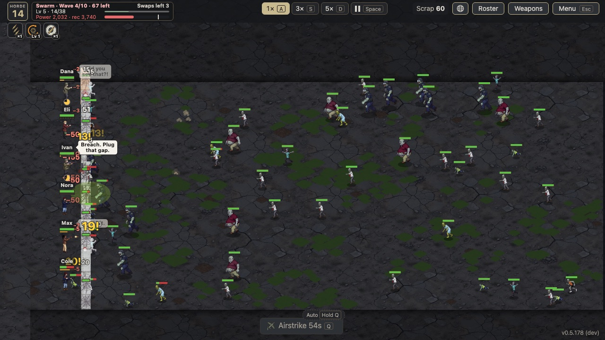
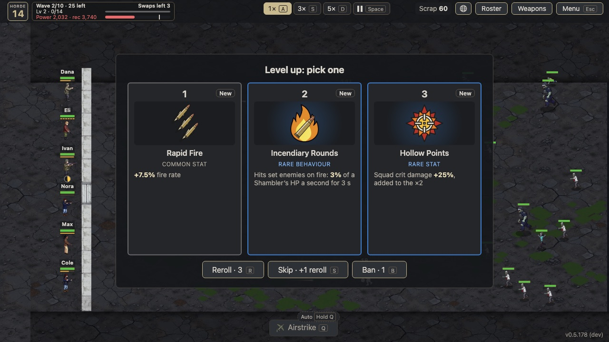
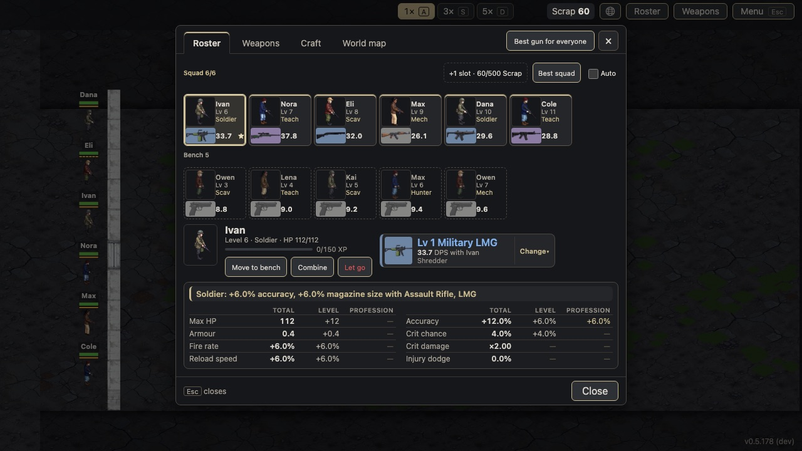
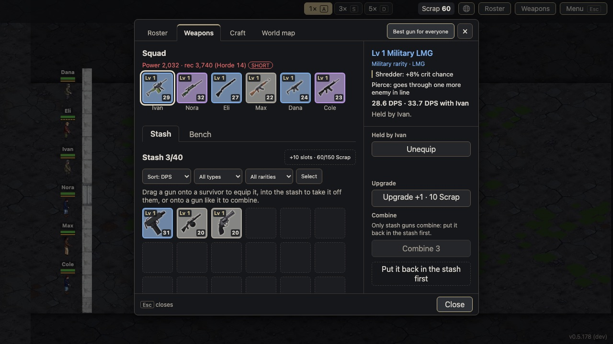
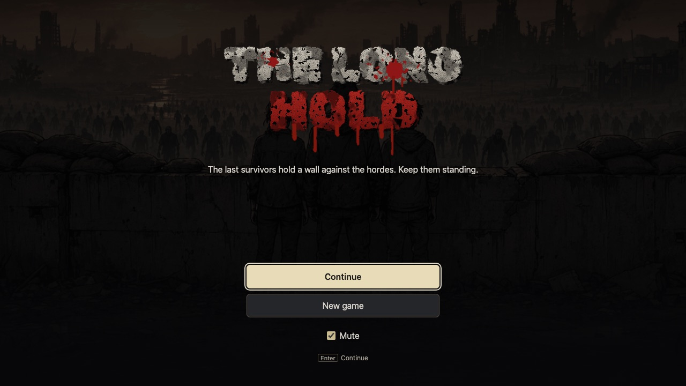

# The Long Hold

[](https://github.com/danhquach/idle-defender/actions/workflows/ci.yml)
[](https://github.com/danhquach/idle-defender/actions/workflows/pages.yml)

**Play the test build:** <https://danhquach.github.io/idle-defender/>



A zombie-survival base-defence game for the browser. Years after doomsday,
you command a fortified base: build barrier layers, power turrets and hold the
line when a horde of zombies and mutated monsters comes. Each horde is a
hands-on roguelite fight; between hordes, patrols cross the world map to loot
the ruins while you're away.

## Status

The test build is the horde-only build, playable in the browser on desktop,
tablet and phone (landscape):

- **Hold the wall.** A squad of 6 survivors (8 with bought slots) shoots on
  its own; click an enemy to focus it. Hordes grow from 5 to 10 waves, with
  swarm waves, elites, eight enemy kinds (from Shamblers and Runners to
  Brutes and Mutated Horrors) and a boss every 10th horde.
- **Level up in the fight.** Kills give fight XP; each level offers three
  cards (stats, behaviours, barriers such as Barbed Wire and Sandbags) with
  reroll, skip and ban. Throwables (Frag Grenades, Flashbang, Molotov), the
  Airstrike on cooldown (aimed, or on Auto) and the Field Repairs card, a
  button that refills the wall when you choose.
- **Grow between hordes.** A win gives survivor XP and drops a gun. Ten guns,
  each with a role and trait, rarities and affixes; equip, upgrade, combine,
  salvage and craft them. Survivors have professions; new ones join the camp,
  which grows past the squad to a bench of up to 40.
- **Manage the camp.** The Roster (squad, bench and patrols), Weapons (squad,
  stash and the bench's guns), Craft and the World map, where a team from the
  bench goes on a real-time patrol to loot the ruins.
- **Harder modes.** Normal, then Nightmare and Hell, with stronger hordes,
  boss skills and better loot.
- **Lose and retry.** A loss costs nothing: the same horde comes again.

The game saves in the browser (with a backup code to move a save). The full
game (base building, power, research) sits behind the same code. The design
is [`docs/design.md`](docs/design.md); work is tracked in GitHub issues.

## Screenshots

|                                                                                             |                                                                                         |
| ------------------------------------------------------------------------------------------- | --------------------------------------------------------------------------------------- |
|                          |  |
| Level up mid-fight: one of three cards                                                      | The Roster: squad, bench, levels and professions                                        |
|  |                                          |
| Weapons: the squad's guns, the stash and a gun's details                                    | The title screen                                                                        |

## Codebase status

- **Version** 0.5.x, a test build; every merged PR raises it (0.5.179 at the
  time of writing). Built with Vite and TypeScript, plain DOM for the menus
  and a 2D canvas for the fight.
- **Layout** ([`docs/architecture.md`](docs/architecture.md) is the code map):
  - `src/core/`: the pure simulation, `tick(state, dt)` (about 15.7k lines in
    31 files). No DOM, storage or UI imports (enforced by ESLint); randomness
    only through a seeded RNG, so a fight replays the same from its seed.
  - `src/ui/`: the page, canvas renderer, HUD and camp window (about 24.8k
    lines in 37 files, plus 8.5k lines of CSS).
  - `src/storage/`: the versioned save, read back through allow-list
    validators, settings and the backup code (about 2.3k lines).
- **Tests:** about 3,950 unit tests in 165 files (Vitest, jsdom for the UI),
  plus 116 balance tests in 22 files that play full fights to keep the
  difficulty curve, guns and cards in line. CI runs lint, build, the unit
  tests and the balance tests on every PR; the PR merges only when all pass.
- **Art and sound:** generated sprite art built from `art-src/` by
  `tools/art/`; third-party assets are credited in
  [`docs/art-credits.md`](docs/art-credits.md) and
  [`docs/audio-credits.md`](docs/audio-credits.md).

## Develop

Needs Node 20.19+ or 22.12+.

```sh
npm ci             # install (also points git at the pre-push hook)
npm run dev        # local dev server
npm run lint       # type-check, ESLint, Prettier
npm test           # unit tests (Vitest), without the balance tests
npm run test:balance  # balance tests (src/core/balance/); one file: npx vitest run <file>
npm run build      # production build in dist/
```

The balance tests play many full fights. Their results are kept in
`.cache/balance/` (git-ignored) under a hash of the simulation code
(`src/core`), Node's version and the test file, so a run with neither
changed replays nothing and takes seconds. Only the current code's
results are kept, so switching to a branch with other `src/core` code
replays them. `BALANCE_CACHE=off` plays everything.

Every PR to `main` raises the version in `package.json`; CI and the pre-push
hook check it.

CI splits the unit tests across four jobs that run at once, because the
balance tests (`src/core/balance/`) play many full fights and take most of
the time. A new test file runs in the last job unless you add it to another
group in `.github/workflows/ci.yml`. Each job keeps its balance results in
the Actions cache, so a PR that leaves `src/core` alone replays no fights.

## License

[MIT](LICENSE)
